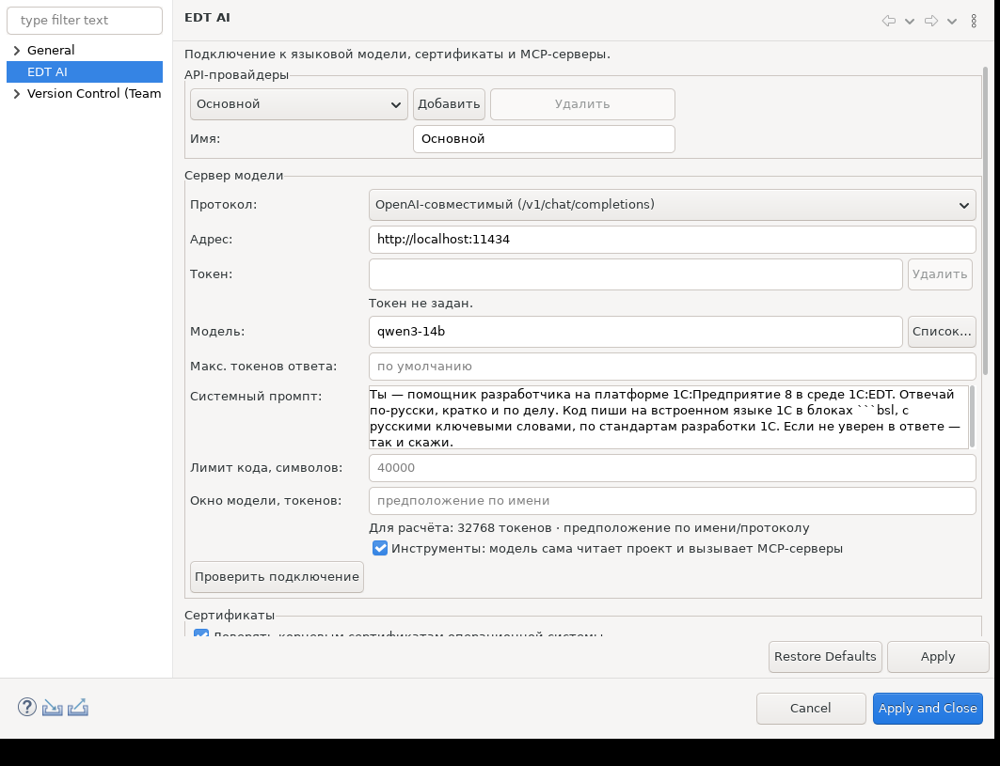
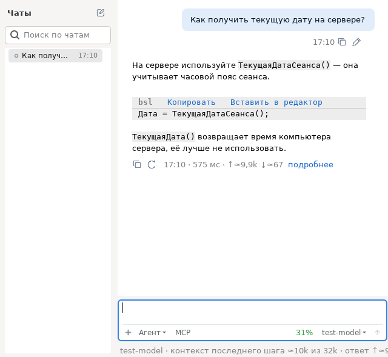

# EDT AI — быстрый старт

EDT AI добавляет в 1C:EDT чат с языковой моделью. В нём можно задавать вопросы по BSL, разбирать код и поручать модели правки.

**[Скачать последний выпуск EDT AI](https://github.com/HansGlorias/EDT_AI_releases/releases/latest)**

## 1. Подготовьте 1C:EDT

Если у вас уже есть 1C:EDT 2025.2 или 2026.1, переходите к установке плагина. Для новой установки можно взять 2026.1.3.

- [Скачать 1C:EDT 2026.1.3 с сайта 1С](https://edt.1c.ru/blog/vyshla-ispravitelnaya-1c-edt-2026-1-3/)
- [Пошаговая установка и запуск 1C:EDT на Windows и Linux](https://dl04.1c.ru/content/DevelopmentTools/2026_1_0/runningedt.html#i076__ustanovka-edt)

## 2. Установите плагин

1. На странице [последнего выпуска](https://github.com/HansGlorias/EDT_AI_releases/releases/latest) в разделе **Assets** скачайте `edtai-update-site-<версия>.zip`. Оставьте файл в ZIP.
2. В EDT откройте **Справка → Установить новое ПО…** (**Help → Install New Software…**).
3. Нажмите **Добавить… → Архив…** (**Add… → Archive…**), выберите скачанный ZIP и подтвердите добавление.
4. Отметьте **EDT AI**. Если список пуст, снимите флажок **Группировать элементы по категории** (**Group items by category**). Снимите флажок **Обращаться во время инсталляции ко всем сайтам обновления для поиска требуемого ПО** (**Contact all update sites during install to find required software**).
5. Нажмите **Далее** (**Next**), примите лицензию и нажмите **Готово** (**Finish**). Если мастер попросит подтвердить доверие к неподписанному содержимому, отметьте элементы EDT AI и подтвердите установку.
6. Перезапустите EDT. Чат откроется через значок **EDT AI** внизу окна или через **Окно → Показать панель → Другое… → EDT AI → EDT AI** (**Window → Show View → Other…**).

## 3. Подключите модель

Подготовьте адрес сервера, имя модели и API-ключ, если его требует сервер. Эти данные выдаёт ваш провайдер или администратор.

1. Откройте **Настройки EDT AI** в заголовке чата или **Окно → Параметры → EDT AI** (**Window → Preferences → EDT AI**).
2. В блоке **Сервер модели** выберите **Протокол**. Для Ollama, LM Studio и OpenAI-совместимых серверов выберите **OpenAI-совместимый**, для API Anthropic — **Anthropic Messages**.
3. Заполните **Адрес**, **Модель** и, при необходимости, **Токен**. Например, для уже запущенного локального Ollama укажите `http://localhost:11434` и точное имя загруженной модели из `ollama list`.
4. Нажмите **Проверить подключение**. Если появилось сообщение «Подключение работает», нажмите **Применить и закрыть** (**Apply and Close**).

## 4. Отправьте первый вопрос

1. Под полем ввода выберите режим **Вопросы**, чтобы получить ответ без изменений в проекте.
2. Напишите, например, «Как получить текущую дату на сервере в BSL?» и нажмите **Enter**. Для новой строки используйте **Shift+Enter**.
3. Чтобы обсудить свой код, выделите его в редакторе BSL и нажмите **Ctrl+Alt+A**. Фрагмент появится в контексте чата. Спросите, например, «Объясни этот код и подскажи, что в нём можно упростить».

Когда захотите поручить модели правку, выберите **Агент**. В этом режиме она может сразу изменить модуль. Проверьте изменения в Git перед коммитом. Для первого чата достаточно подключения к модели, EDT-MCP можно добавить позже.
